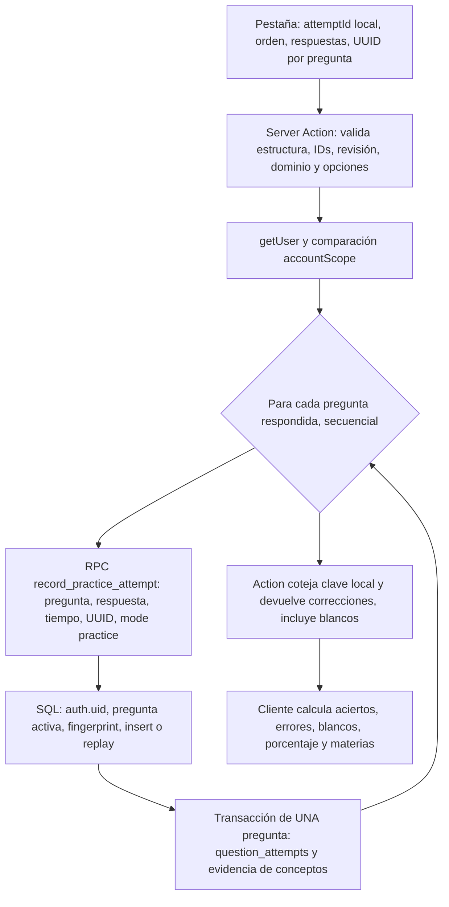

# ADIF 360 — Ciclo 20 · Integridad y contrato de servidor

## Estado y alcance

Auditoría del checkout `main` en `9efd1abbe92a9e04aaa61089c265c2794ff4d581`, con modificaciones y archivos sin seguimiento preexistentes conservados. Las migraciones son evidencia de código local, no prueba del esquema desplegado. No se han modificado Supabase, migraciones, autenticación, datos ni gates de fuentes. La recuperación local y los Web Locks son controles de experiencia, no una transacción.

## Flujo real actual

El `attemptId` de simulacro permanece en el navegador: la Action no lo recibe ni existe agregado de entrega para este flujo. `accountScope` es hash truncado del ID de usuario, no credencial; la autorización procede de `getUser` y `auth.uid()` de la RPC. Se aceptan preguntas del repositorio original revisadas de un único dominio; no se comprueba selección previa firmada, duración, intento persistido ni deadline en servidor. La RPC obtiene la clave del registro privado, almacena `question_attempts` y evidencia por concepto en su propia transacción, no recibe los blancos ni el intento completo. La clave única `(user_id, client_event_id)` y fingerprint de pregunta, opción, tiempo y modo permiten replay idéntico por respuesta en el SQL local; una carga diferente para ese UUID dispara `23514`. Cada pregunta contestada es una llamada independiente. La corrección íntegra se reconstruye de nuevo desde el catálogo y respuestas enviados; el resultado global no queda persistido como tal.

Si la llamada 1 tiene éxito y la 2 falla, la primera ya puede estar confirmada. Un fallo de red también puede ocultar que la última llamada se completó. No existe rollback del conjunto ni consulta fiable del resultado de la entrega; una copia con claves nuevas puede generar evidencia adicional. Un simulacro sin respuestas puede devolver las soluciones tras invocar la Action y no escribe ningún intento en base. La protección de soluciones es de interfaz, no certificación o garantía contra clientes manipulados.

## Cambios seguros y riesgos

- El código `23514` también identifica errores de validación. Ya no se clasifica un conflicto por comparación del mensaje en inglés: una respuesta ambigua, error de transporte, respuesta malformada o discordancia de claves se marca `submission_unknown`. Se preserva el envío congelado y no se reenvía automáticamente. La interfaz permite reintentar expresamente con los mismos UUID; no garantiza seguridad transaccional, especialmente si otra Action sigue en vuelo. Un conflicto real también queda como desconocido mientras el contrato no devuelva una señal inequívoca; así se evita afirmarlo falsamente, a costa de no poder distinguirlo.
- `P0002` indica ausencia de un objeto esperado en el SQL local; se detiene el reintento automático y se muestra error recuperable con aviso de escrituras previas posibles. Puede necesitar intervención y no prueba que nada se haya guardado.
- Tests con RPC simulada muestran dos llamadas, fallo en la segunda y reutilización idéntica de parámetros y UUID al reintentar. No demuestran filas realmente almacenadas ni carreras reales. Los E2E usan fixtures locales; la confirmación perdida se simula procesando la petición del fixture y abortando la respuesta.
- SQL local: `record_practice_attempt` es `SECURITY DEFINER`, verifica `auth.uid`, restringe permisos y obtiene pregunta activa; RLS y revocaciones se han inspeccionado estáticamente. El control `accountScope` bloquea el cambio accidental de cuenta en Action bajo mocks. No se ha probado RLS, autorización de dos cuentas ni persistencia en una base segura real. Hay contenedores locales preexistentes pertenecientes a otros trabajos: no se han alterado ni asumido desechables.
- El SQL local de `practice_sessions` contiene al final las líneas literales `MD` y `echo "done"`, incompatibles con SQL. Su estado de aplicación es desconocido. Además, la inspección identifica orden de control de versión antes de replay en `save_practice_answer` y una operación de finalización que no devuelve un resultado completo inmutable en replay. Requiere validación aislada y reparación autorizada antes de reutilizarla; no se ha modificado.
- Una revisión adversarial independiente inspeccionó alcance de cuenta, registros, permisos, concurrencia y clasificación. Riesgos pendientes: IDs y almacenamiento manipulables, ausencia de autoridad del intento y plazo, claves accesibles mediante petición de entrega, duplicación de evidencia con claves nuevas y acciones directas, inconsistencia entre catálogo y registro, y concurrencia transversal. La revisión estática no acredita la seguridad real.

## Contrato transaccional propuesto — no implementado

Antes de escribir esquema, inspeccionar despliegue y evaluar adaptación de `simulation_attempts` / `simulation_answers` y su RPC transaccional existente, que actualmente atiende un contrato y elegibilidad distintos. No reutilizarla ni ampliar allowlists sin verificar procedencia y aislamiento de preguntas originales. `practice_sessions` también necesita resolver sus limitaciones. Solo si no pueden representar el contrato, proponer agregado nuevo con migración correctiva separada y reversible.

Datos mínimos: intento UUID único, propietario derivado de autenticación, modalidad, versión y hash de banco/selección, orden e IDs presentados, configuración orientativa y tiempos/deadline, estado `in_progress | submitted | expired` y marcas temporales; respuestas por pregunta con blanco explícito; resultado y revisión inmutables vinculados a versión; ID de idempotencia y hash canónico del payload, con unicidad por propietario y operación. `conflict` debe ser respuesta de operación estable, no necesariamente alterar el estado persistido del intento. Para abandono se necesita estado o evento explícito y política autorizada. Las claves/expli­caciones solo se entregan tras finalización autorizada.

Una operación de finalización: autentica, comprueba propiedad y bloquea el agregado (`FOR UPDATE` u otra serialización equivalente); verifica replay idempotente y hash antes de rechazar por estado; valida versión y elegibilidad de todas las preguntas, excluye material histórico retenido y opciones inválidas; comprueba deadline/reglas; calcula resultado desde clave autorizada; inserta respuestas, blancos, resultado y evidencia exactamente una vez dentro de una transacción; guarda recepción inmutable. Repetición idéntica autorizada devuelve la misma recepción y resultado; carga distinta para la misma identidad devuelve `ATTEMPT_CONFLICT` estructurado y estable; propietario distinto no obtiene información. Una restricción única por propietario e intento y otra por clave de operación, más el bloqueo, deben acompañar al control lógico. No depender de `localStorage` ni Web Locks. La operación y su semántica solo serán garantía después de ejecutar pruebas reales de carrera, rollback y replay.

RLS propuesta: lectura únicamente del propietario, sin escrituras directas de cliente al agregado/resultados; funciones con privilegios mínimos, `search_path` fijado, validación explícita `auth.uid()`, revocación de `PUBLIC`/`anon` y concesión limitada. Versionar contenidos y reglas permite reproducir nota; no confiar en puntuación recibida del cliente. Evitar doble registro: decidir si el cierre genera evidencia única vinculada a sus respuestas o si la reutiliza con IDs deterministas; no ejecutar además la ruta individual actual sin deduplicación transaccional.

## Historial, privacidad y decisiones pendientes

Propuesta de lectura autenticada por propietario: lista de finalizados y abandonados, fecha, modalidad y resumen; detalle con preguntas, respuestas, blancos y explicaciones versionadas; comparación de porcentaje y desglose por materia sin confundir con práctica individual. Recuperación entre dispositivos requiere estado de intento y sincronización autorizada; no existe hoy. Exportación y eliminación deben contemplar respuestas y evidencia derivada, con confirmación del alcance y sin afectar a otros usuarios. Retención de borradores, resultados, logs de seguridad, anonimización y borrado en cascada quedan pendientes de decisión del usuario; no se fija política. Minimizar datos personales y no guardar claves en borradores cliente.

## Plan reversible y aceptación futura

1. Confirmar inventario de esquema aplicado, permisos, fuentes, integridad de migraciones y política de datos en entorno aislado con cuentas sintéticas; decidir reutilización y contrato antes de tocar producción.
2. Implementar migración nueva y RPC en entorno desechable autorizado, con rollback probado y sin cambiar gates de procedencia; activar tras revisión independiente.
3. Probar dos cuentas reales sintéticas con RLS y acceso cruzado, claves y modos ajenos; respuestas/blancos, catálogo versionado, expiración y validación de preguntas retenidas.
4. Inyectar fallo tras escrituras intermedias y verificar cero efectos parciales; repetir tras pérdida de confirmación y obtener misma recepción y una sola evidencia; carrera simultánea idéntica y distinta, sin duplicados, con resultado o conflicto estable.
5. Verificar lectura de historial, recuperación entre dispositivos, eliminación/exportación autorizadas y política de retención; ensayar reversión y observabilidad antes de cualquier despliegue.

## Validación del ciclo

Los resultados ejecutados y sus límites se registran al finalizar la verificación. Los gates históricos permanecen sin cambios. **Servidor real y persistencia real: NO VERIFICADOS**; ninguna prueba mock acredita RLS ni transacción en base.

Evidencia ejecutada en este ciclo: `pnpm typecheck` PASS; `pnpm verify:content` PASS; `pnpm test` 100 archivos, 742/742 PASS; pruebas focalizadas Action/interfaz 22/22 PASS; Playwright Chromium 21/21 PASS incluyendo cuatro modalidades, recuperación, secuencial, simultánea y confirmación perdida con fixtures; `git diff --check` PASS. Las pruebas de identidad usan mocks, no sesión real. El test de escritura parcial simula RPC sucesivas y su respuesta: no demuestra una escritura física en PostgreSQL. El entorno navegador simulado tampoco acredita unicidad o persistencia reales.

La segunda revisión adversarial propone conservar el mensaje exacto conocido para detectar conflicto determinista. Se ha optado por cumplir el requisito de no depender de ese texto: mientras `23514` agrupe condiciones distintas, se comunica incertidumbre. Consecuencia conocida: reintentar explícitamente un conflicto real con la misma carga puede volver a fallar y no recuperar el resultado. Se requiere un código o resultado estructurado específico en el futuro contrato; no existe en el contrato actual. `P0002` permite conservar y gestionar el borrador, pero no lo repara automáticamente.

Estados: **cliente PASS para escenarios mock comprobados, con límites indicados**; **contrato diseñado PASS como especificación revisada, sin implementación**; **servidor real NO VERIFICADO**; **persistencia real NO VERIFICADA**. La operación futura y la política de conservación requieren autorización posterior.

Verificación adicional: `e2e/study-flow.spec.ts` y `e2e/mobile.spec.ts` 2/2 PASS, con los controles visibles de los 102 enunciados y los formularios históricos, escritorio y viewport móvil; son pruebas del entorno simulado.
